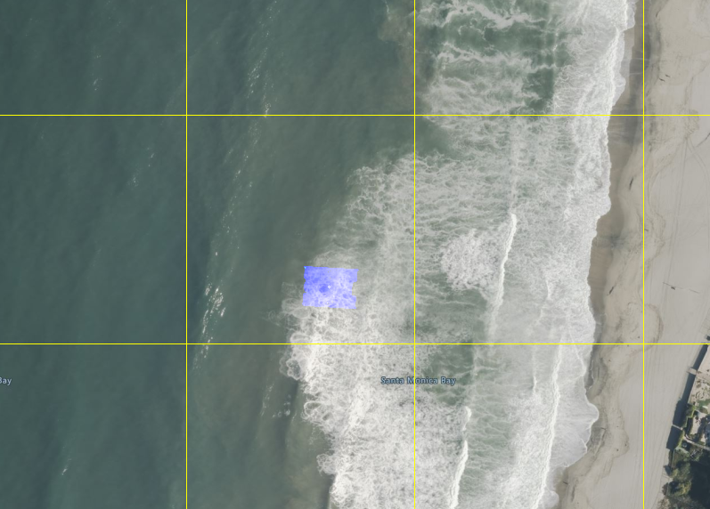
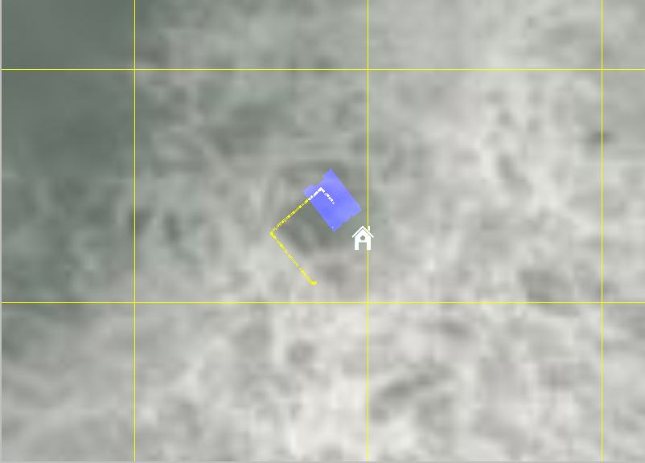
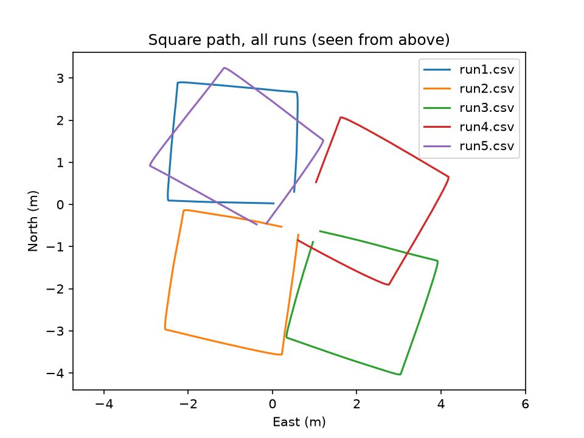

# Autonomous AUV Square Mission (ArduSub SITL)

A Python mission controller that drives a simulated underwater vehicle with no human input.
It dives to a target depth, drives a square using a heading controller, and surfaces.
It talks to the ArduSub autopilot over MAVLink, the same way it would talk to a real Pixhawk. 
The vehicle is simulated at an ocean site in Santa Monica Bay, CA (ArduPilot's RATBeach location).

Built as groundwork for the GMU RoboSub team's autonomy software.
 
Simulated sub at the ocean site in Santa Monica Bay Sub driving its square, zoomed in

<i>Top: the simulated sub (blue) at the ocean site. Bottom: zoomed in mid-mission; the yellow line is its path.</i>

## How it works

1. **Dive:** push down toward -2 m, slowing down for the last 0.5 m, then hold depth (ArduSub `ALT_HOLD` mode)
2. **Square:** record the starting heading, then for each of the 4 sides,
   turn to the next heading (+90°) using a proportional controller, then drive forward 5 s while still steering
3. **Surface:** push up until near the surface, then disarm

Every 0.1 s the script sends commands, reads depth, heading and position, and logs a row to a CSV.

## Results

Each version was tested over 5 runs.

| Version | Depth error | Heading error | Square miss |
|---------|-------------|---------------|-------------|
| V1: full-speed dive | 0.39 m | 6.4° | 0.46 m |
| V2: slow dive near target | **0.03 m** | 6.5° | 0.60 m |

- **Depth error:** average distance from the -2 m target after the dive
- **Heading error:** average degrees off the target heading while driving each side
- **Square miss:** distance between where the square started and ended (sides are about 3 m)

### V1: full-speed dive

| Run | Depth error | Heading error | Square miss |
|-----|-------------|---------------|-------------|
| 1 | 0.39 m | 6.3° | 0.35 m |
| 2 | 0.39 m | 6.6° | 1.20 m |
| 3 | 0.40 m | 6.5° | 0.33 m |
| 4 | 0.39 m | 6.0° | 0.21 m |
| 5 | 0.39 m | 6.4° | 0.23 m |

V1 dived at full speed until it passed -2 m. The sub kept coasting and settled at about -2.4 m,
then held that wrong depth steadily. Each turn also overshot by about 6°, which skews the corners slightly.

### V2: slow dive near target

| Run | Depth error | Heading error | Square miss |
|-----|-------------|---------------|-------------|
| 1 | 0.03 m | 6.5° | 0.56 m |
| 2 | 0.03 m | 6.0° | 0.44 m |
| 3 | 0.03 m | 6.2° | 0.31 m |
| 4 | 0.02 m | 7.3° | 1.44 m |
| 5 | 0.03 m | 6.5° | 0.23 m |

**Fix:** dive fast (throttle 1350) until 0.5 m above the target, then slowly (1450) for the last 0.5 m.
This cut depth error from about 0.39 m to 0.03 m, roughly 13 times better.
Heading error and square miss stayed about the same, as expected, because the fix only changed the dive.



## Next steps

- Reduce the ~6° heading overshoot (e.g. add a derivative term, making it a PD controller)
- Wrap the mission in ROS 2 nodes (telemetry node + mission node)

## How to run it

Requires ArduPilot SITL and pymavlink (installed by ArduPilot's `install-prereqs-ubuntu.sh`).

```
# terminal 1: start the simulator
sim_vehicle.py -v ArduSub -L RATBeach --console --map

# terminal 2: run the mission, then analyze
python3 mission.py
mv mission_log.csv run1.csv      # repeat for run2..run5
python3 results.py
```
