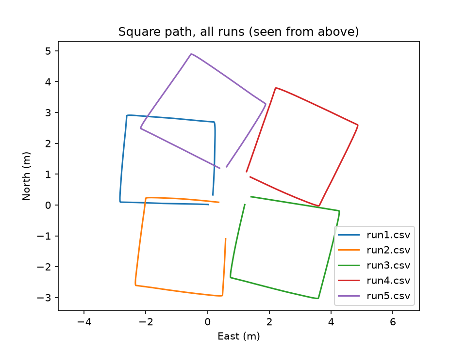

# Autonomous AUV Square Mission (ArduSub SITL)

A Python mission controller that flies a simulated underwater vehicle with no human input:
it dives to a target depth, drives a square using a heading controller, and surfaces.
It talks to the ArduSub autopilot over MAVLink, the same way it would talk to a real Pixhawk.

Built as groundwork for the GMU RoboSub team's autonomy software.

## How it works

1. **Dive:** push down until depth reaches -2 m, then hold depth (ArduSub `ALT_HOLD` mode)
2. **Square:** record the starting heading, then for each of 4 sides:
   turn to the next heading (+90°) using a proportional controller, then drive forward 5 s while still steering
3. **Surface:** push up until near the surface, then disarm

Every 0.1 s the script sends commands, reads depth, heading and position, and logs a row to a CSV.

## Results (5 runs)

| Run | Depth error | Heading error | Square miss |
|-----|-------------|---------------|-------------|
| 1 | 0.39 m | 6.3° | 0.35 m |
| 2 | 0.39 m | 6.6° | 1.20 m |
| 3 | 0.40 m | 6.5° | 0.33 m |
| 4 | 0.39 m | 6.0° | 0.21 m |
| 5 | 0.39 m | 6.4° | 0.23 m |

- **Depth error:** average distance from the -2 m target after the dive
- **Heading error:** average degrees off the target heading while driving each side
- **Square miss:** distance between where the square started and ended (~3 m sides)



**What the numbers show:** both errors are consistent offsets, not noise.
The sub overshoots to about -2.4 m and then holds that depth steadily,
and each turn overshoots by about 6°, which skews the corners slightly.

## How to run it

Requires ArduPilot SITL and pymavlink (installed by ArduPilot's `install-prereqs-ubuntu.sh`).

```
# terminal 1: start the simulator
sim_vehicle.py -v ArduSub -L RATBeach --console --map

# terminal 2: run the mission, then analyze
python3 mission.py
mv mission_log.csv run1.csv      # repeat for run2..run5
python3 results.py
```

## Files

- `mission.py`: the autonomous mission
- `results.py`: computes the accuracy table and draws all paths
- `plot_mission.py`: depth and heading over time for one run
- `run1.csv` … `run5.csv`: logs from the 5 trials
